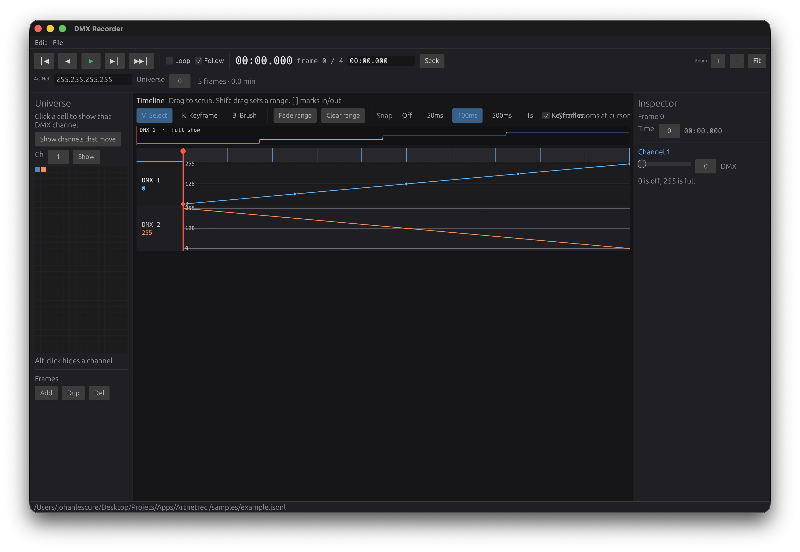

# DMX Recorder

Edit, play, and record shows for standalone DMX players. A show is a timeline of DMX frames, one universe of 512 channels. Playback leaves the machine as Art-Net.

The application file is [JSON Lines](FORMAT.md): `.jsonl`. One line is one look. A line stores the channels that are on, so a scene held for hours stays one line, and channels left at zero take no space. A text editor or an AI can change a look by editing that line.



A recorder has its own file format. The editor imports that file into `.jsonl` and exports `.jsonl` back out when the recorder needs it. Showtec TR-512 `.NCOD` (the show) and `.COF` (the configuration) are the first of those formats. Restoring a `.COF` does not restore a missing show file.

TR-512 byte layouts are documented in [samples/Showtec TR-512/NCOD_README.md](samples/Showtec%20TR-512/NCOD_README.md) and [samples/Showtec TR-512/COF_README.md](samples/Showtec%20TR-512/COF_README.md).

## Devices

| Device | Code | Files |
| --- | --- | --- |
| Showtec TR-512 | 50825 | Import and export `.NCOD` / `.COF`. |

`src/show.rs` is the timeline. `src/showfile.rs` reads and writes `.jsonl`, and dispatches import and export through the device list. `src/devices/` is that list. The TR-512 codecs live in `src/devices/tr512/`.

## Adding a device

1. Add `src/devices/<name>/` with a reader and a writer between that recorder's bytes and `show::Show`.
2. Publish a `DEVICE` constant and append it to `DEVICES` in `src/devices/mod.rs`.
3. Set `show` to a `ShowFormat` once the bytes are known. `detect` must recognize only that file, by its magic, not by a guess. Open, Save, and Export then pick the codec up from `show_formats()`. No second editor.
4. Add the device to `DEVICES` only when `show` can read and write. The welcome screen lists `DEVICES`, and only supported devices are shown.
5. Put dumps in `samples/<device>/`. A configuration with its own screen, such as the TR-512 `.COF`, is optional and separate: `open_config` in that device's module, plus a view. It is not part of the show codec.

The player and the editor call `showfile::parse_show` and `showfile::write_show`. They do not name a recorder. A new codec is visible there only through `DEVICES`.

## Build

```shell
cargo build --release
cargo test
```

## Editor

```shell
cargo run --release --bin tr512-gui
```

Open, edit, save, and play a `.jsonl` show. Open also imports every device in `DEVICES` that has a codec. Save writes the format of the current file. Save As writes `.jsonl` unless the name ends in a device extension. Export writes that device's show and leaves the open file alone.

On a show timeline:

- Scroll zooms on the time under the cursor. Pinch, or Ctrl/Cmd+scroll, does the same.
- A horizontal swipe, or Shift+scroll, pans. Middle-drag or right-drag pans without changing the zoom.
- Drag scrubs, including while playback is running. Playback jumps to that frame and continues. The current zoom stays put.
- Space starts and stops Art-Net playback from the playhead.

The default Art-Net target is `255.255.255.255:6454`, universe 0. Change both in the transport bar.

## Play a show

```shell
cargo run --release --bin ncod-artnet -- samples/example.jsonl
cargo run --release --bin ncod-artnet -- show.NCOD -t 192.168.1.20 -u 0 --loop
```

| Option | Meaning |
| --- | --- |
| `-t`, `--target <ip[:port]>` | Node or broadcast. Default `255.255.255.255:6454` |
| `-u`, `--universe <0-32767>` | Art-Net universe. Default `0` |
| `-l`, `--loop` | Repeat until interrupted |

Frames are sent on their absolute timestamps. The Art-Net sequence runs from 1 to 255. The player reads `.jsonl` and Showtec TR-512 `.NCOD`.

## Examples

`samples/example.jsonl` is a 2-second show: channel 1 rises 0 → 255 and channel 2 falls 255 → 0, one frame every 500 ms. `samples/Showtec TR-512/example.NCOD` is the same show exported for a TR-512. `samples/Showtec TR-512/example.COF` is a TR-512 configuration that plays that file from trigger 1 and as the idle show.

## Samples

`samples/Showtec TR-512/Raw_files/RECORDER/SH-001.NCOD` is a recorder dump (1,207 frames, last timestamp 43,739 ms). `samples/Showtec TR-512/Raw_files/CONFIG/` holds configuration backups from factory `Conf-002.COF` through `Conf-011.COF`, plus `Lamp-OK.COF`. `cargo test` checks that those files parse and round-trip.
